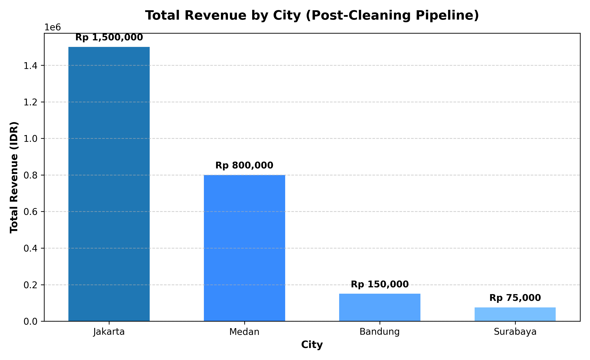

# E-Commerce Sales Cleaning & Analytics Pipeline

An automated data pipeline and analytics workflow built with **Python**, **DuckDB**, and **Matplotlib**. This project demonstrates end-to-end handling of dirty e-commerce transactional data, SQL-based data cleaning, aggregation, and executive-level visualization.

---

## Business Problem
In real-world e-commerce databases, raw transactional records often suffer from:
1. **Inconsistent naming conventions** (e.g., typos like `Jakrta` and abbreviations like `JKT`).
2. **Anomaly values** (negative sales `-50,000` or zero values `0`).
3. **Corrupted or missing attributes** (`NULL` product categories).

Uncleaned data leads to inaccurate business metrics and skewed regional revenue reporting.

---

## Tech Stack
- **Database Engine:** [DuckDB](https://duckdb.org/) (High-performance in-memory analytical SQL engine)
- **Language:** Python 3.x
- **Visualization:** Matplotlib

---

## Data Pipeline Architecture

```
[Raw Ingestion] ──► [SQL Data Cleaning] ──► [Analytical Aggregation] ──► [Executive Chart]
 (Typo, NULL,       (CASE WHEN normalization,     (GROUP BY, SUM,            (High-DPI PNG)
  Negative values)    Filter anomalies)            ORDER BY DESC)
```

### Data Cleaning Rules Implemented:
- **Location Normalization:** Consolidated `Jakrta`, `JKT`, and `Jakarta` into a unified `Jakarta` dimension.
- **Anomaly Exclusion:** Filtered out erroneous records where `amount <= 0`.
- **Integrity Validation:** Discarded rows containing `NULL` categories.

---

## Key Insights & Results



1. **Jakarta** represents the highest-performing market with a total validated revenue of **Rp 1,500,000** across multiple categories.
2. **Medan** follows as the second-largest contributor (**Rp 800,000**), primarily driven by the Automotive segment.
3. Automated cleaning prevented revenue distortions caused by negative pricing and fragmented city reporting.

---

##s How to Run Locally

1. **Clone the repository:**
   ```bash
   git clone https://github.com/USERNAME/ecommerce-sales-pipeline.git
   cd ecommerce-sales-pipeline
   ```

2. **Install dependencies:**
   ```bash
   pip install -r requirements.txt
   ```

3. **Execute the pipeline:**
   ```bash
   python main.py
   ```
